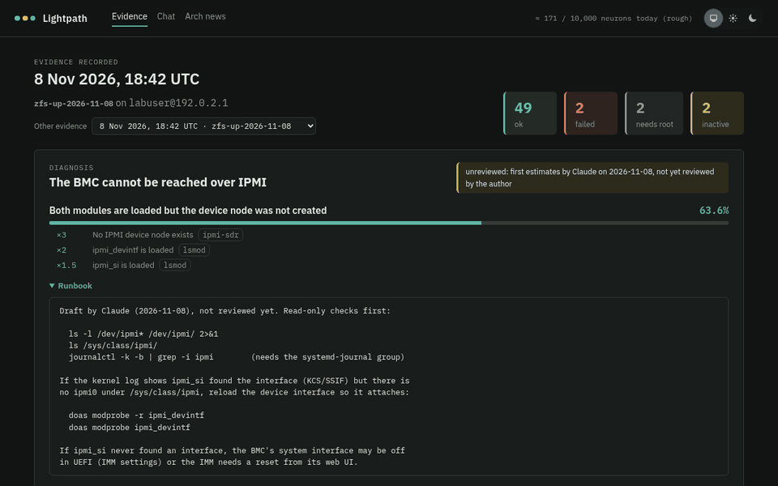

# Lightpath (`cf_ai_lightpath`)

A read-only AI copilot for one homelab server: an IBM x3850 X6 running Arch
Linux, ZFS, libvirt and kubeadm. It is named after IBM's *Light Path
Diagnostics*, the LEDs on the front of that server that point at the part
that failed.

Lightpath collects what the server says about itself (read-only commands),
ranks the likely causes of a failure with plain, explainable rules, and uses
Workers AI to explain the evidence, answer questions with memory, and digest
Arch Linux news against the packages actually installed.

Its first case was real: the ZFS pools went down because the running kernel
was newer than the one `zfs-dkms` supported. The recorded evidence of that
outage, and of the fix, is in the demo.

**Live demo:** https://lightpath.ambitioussmoke-cb8aa9fd.northeurope.azurecontainerapps.io
(it scales to zero when idle, so the first visit takes a few seconds).



## How it maps to the assignment

| Requirement | Where |
|---|---|
| **LLM** | Workers AI: Llama 3.1 8B answers first; Llama 3.3 70B when the routing rules escalate ([`worker/src/routing.ts`](worker/src/routing.ts)) and for the Arch news digest. |
| **Workflow / coordination** | Two Cloudflare Workflows ([`worker/src/workflows.ts`](worker/src/workflows.ts)): **triage** (8B, rule check, maybe 70B, store, count) and **Arch news** (fetch the feed, match packages in code, 70B digest, cache), started by a daily cron or on demand. Every step is checkpointed and retried at most once. |
| **Chat input** | The chat page (`/chat`) asks through the triage Workflow; each conversation is kept by a Durable Object. "Suggest a fix" on every diagnosis uses the same path. |
| **Memory / state** | Durable Objects with SQLite: `Session` (one per conversation, its messages), `Ledger` (a rough daily neuron estimate), `NewsStore` (installed packages and digests). |

## Architecture

```
 homelab (read-only)            this repo                         Cloudflare
 ┌──────────────────┐  ssh   ┌───────────────┐            ┌──────────────────────────────────┐
 │ probe (Go)       │───────►│ raw output    │            │ Worker (TypeScript, no deps)     │
 │ 55 fixed commands│        │ (private)     │            │  JWT auth · rate limit · routes  │
 │ no shell, no root│        └──────┬────────┘            │  ├ Session DO   chat memory      │
 └──────────────────┘     scrub (Go)│                     │  ├ Ledger DO    neuron estimate  │
                                    ▼                     │  ├ NewsStore DO packages, digests│
                         ┌──────────────────┐   HTTPS+JWT │  ├ Workflow triage (8B → 70B)    │
  reviewer ── browser ──►│ web app (Elixir) │────────────►│  ├ Workflow news  (cron, 70B)    │
                         │ evidence, Bayes  │             │  └ Workers AI via AI Gateway     │
                         │ ranking, Explain │             └──────────────────────────────────┘
                         └──────────────────┘
                     Docker; demo on Azure Container Apps (scales to zero)
```

- **Probe** ([`probe/`](probe)): a fixed list of read-only commands run over SSH, never through a shell, each with a timeout and an output cap. A test rejects any package-manager command that is not a query.
- **Scrubber** ([`probe/scrub`](probe/scrub)): replaces IPs, MACs, serials, UUIDs, hostnames and names with stable placeholders, and fakes about two thirds of the package versions with a keyed hash. It re-checks its own output for leaks. Only the scrubbed set ([`fixtures/public`](fixtures/public)) is in the repo.
- **Diagnosis** ([`lightpath/lib/lightpath/diagnosis.ex`](lightpath/lib/lightpath/diagnosis.ex)): facts extracted from the evidence, then Bayes: prior × likelihood ratios, normalised, with an "other" bucket. The rules are JSON ([`priv/rules`](lightpath/priv/rules)): ZFS pools down, kubelet down, IPMI unreachable, LAN port below its speed. Every percentage shows which evidence moved it. **The LLM never produces the numbers.**
- **Runbooks** ([`priv/runbooks`](lightpath/priv/runbooks)): one text file per cause, written by a person, shown under the cause. "Suggest a fix" sends the scored ranking and the top cause's runbook to the model, which is told not to re-rank.
- **Pages**: evidence (with a picker for every recorded set, so before/after can be compared), chat, and Arch news (digest of the last 30 days, matched against the installed packages from the evidence).
- **Worker** ([`worker/`](worker)): every route is documented in [`src/index.ts`](worker/src/index.ts).
- **Live probe** ([`probe/cmd/lightpathd`](probe/cmd/lightpathd), packaged in [`deploy/arch`](deploy/arch)): event-driven, like a small SIEM. It follows the systemd journal (unit state changes by systemd's message ids, kernel warnings and link changes, and package transactions reported by ALPM hooks), maps each event to the probes it makes relevant ([`correlate`](probe/correlate)), batches bursts, re-runs only those, scrubs the result and publishes a new evidence set. It runs as an unprivileged `hlprobe` user with `NoNewPrivileges` and no root at all; "Re-probe now" and the event timeline reach it over a unix socket. Events and sets are kept 90 days, which also keeps the precedents of a failure (the kernel upgrade before the ZFS outage) on record.

## Run it locally

Needs Docker with Compose and BuildKit (the `docker-buildx` plugin), and Make. Workers AI runs on Cloudflare even in
dev, so you need a Cloudflare account (the free plan is enough).

```sh
cp .env.example .env     # fill in; each line says how to get its value
make dev                 # web app + wrangler dev, http://localhost:4100
```

Open the page as `localhost`, not `127.0.0.1`: LiveView only accepts its
websocket from the host in `PHX_HOST`.

The API token can be made by hand (the comment in `.env.example` lists what
it needs) or as code: [`deploy/terraform/token.tf`](deploy/terraform/token.tf),
applied with a short-lived bootstrap token.

## Deploy

Infrastructure is Terraform only; no vendor CLI is needed to deploy.

1. **Worker**: `make deploy` (needs `esbuild` and `terraform`). It bundles the
   Worker and applies [`deploy/terraform/worker`](deploy/terraform/worker):
   the script, its Durable Objects, both Workflows, the cron, the AI Gateway
   and the `workers.dev` route. The same Terraform renders
   `worker/wrangler.jsonc` for local dev (`make wrangler-config`), so
   bindings are written down once.
2. **Image**: pushing to `master` runs
   [`.github/workflows/image.yml`](.github/workflows/image.yml), which pushes
   `ghcr.io/<owner>/cf_ai_lightpath:<sha>` with the public fixtures inside.
   The package must be public for Azure to pull it.
3. **Demo**: fill in `deploy/terraform/azure/terraform.tfvars` (from the
   `.example`), then `make azure`. Container Apps scales to zero when idle,
   keeps no logs, and a 1-per-month budget emails before it can cost
   anything.

Secrets (`.env`, `*.tfvars`, Terraform state) are gitignored and passed to
Terraform by the Makefile, so each value has one home.

## Tests

```sh
make test     # Go, Elixir and Worker suites
```

The tests were written before each implementation, from the function names
and documentation only, and then checked by mutation testing: the code is
broken on purpose in small ways, and each change must make a test fail. The
mutants that survived pointed at real gaps, which each got a test.

- Worker: `node --test` on Node 26 (native TypeScript), with real SQLite
  (`node:sqlite`) standing in for the Durable Objects' storage. No npm
  dependencies.
- Elixir: ExUnit, including an acceptance test on the real ZFS evidence.
- Go: standard library only.

## Security and cost

- The probe only reads; nothing runs as root. The server is never changed by this project.
- The web app and the Worker share an HS256 secret: every Worker request carries a 60-second JWT. Only `/api/health` is open.
- AI routes are rate-limited per token subject, and go through an AI Gateway that caches identical prompts.
- The free plan has 10,000 neurons a day. The Worker keeps a rough running estimate, used only for display: when a call fails, the error says whether the daily allowance is probably the cause.
- Containers run read-only, with every capability dropped and `no-new-privileges`.

## Status and known limits

- The public demo shows recorded sets; live mode (`make home`, on the server with `lightpathd` installed) shows the daemon's sets as they appear.
- AI answers can be wrong; the UI labels them "AI-generated · unscored · AI can make mistakes". Asked without context, both models suggested `modprobe zfs`, which cannot work here: the module is not built for the running kernel. The Bayes ranking gets this right (97.5% "kernel newer than zfs-dkms supports"), and with the ranking and runbook in the prompt the answers follow it.
- The rule priors are first estimates and over-confident; a second mechanism (a floor for "something else", or a "check next" step) is planned.
- Package matching for the news is word-based and over-matches common words (`which`, the "Linux" in "Arch Linux").

## How this was built

With Claude Code, in small reviewed steps. The full prompt history is in
[`PROMPTS.md`](PROMPTS.md); the instructions and memories the assistant had
loaded are in [`ai-history/`](ai-history). Personal details are redacted and
marked.

## Layout

```
probe/        Go: inventory runner, scrubber, and the live daemon (events, correlate, store)
fixtures/     public, scrubbed evidence (raw output never leaves the machine)
lightpath/    Elixir/Phoenix web app: evidence, diagnosis, Explain
worker/       Cloudflare Worker: routes, Durable Objects, Workflows
deploy/       Terraform (token, Worker, Azure) and the kubeadm/Cilium runbook
```
